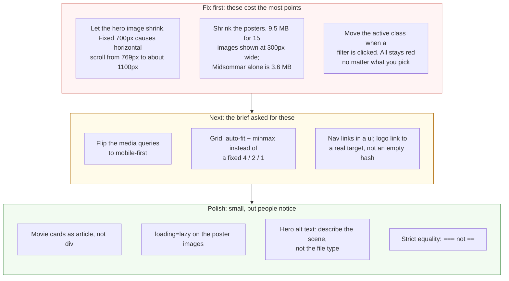

# Project 1: Static Foundations — Feedback

**Student:** Jennifer Guinanzaca · **Repo:** [JenniferGuinanzaca/Dead-Frame](https://github.com/JenniferGuinanzaca/Dead-Frame) · **Live:** [deadframe-csc436.netlify.app](https://deadframe-csc436.netlify.app/)
**Reviewed at commit:** `b20d482` · **Course:** CSC 436, Fall 2026

> **How this review was made.** Your instructor reviewed this project with [Claude](https://claude.com) (Anthropic's AI) as a second set of eyes. Claude cloned the repo, read every line, loaded the live site at 375, 768, 900, 1024, 1200 and 1280 pixels wide, ran the W3C validator, clicked every filter button and counted the cards, weighed the images, and read the console. Every note and every point below was read and approved by your instructor. Same standard, same rubric, just more time spent looking at *your* code than one human has in a grading week.

## Grade: 84 / 100

| Category | Points | Earned | One line |
|---|:-:|:-:|---|
| Semantic HTML | 20 | 18 | Valid, clean outline, every element the brief lists; nav links aren't a list, cards are `div`s |
| CSS layout | 25 | 22 | Flexbox nav, hero and filters, Grid gallery, a real dark palette; a fixed-width image and a fixed 4-column grid |
| Responsive design | 15 | 11 | Perfect at 375 and 768; horizontal scroll from 769px to about 1100px because of one `width: 700px` |
| JavaScript interaction | 15 | 12 | Cards built from data, filter works and is clean; the active button never moves |
| Repository and deployment | 15 | 14 | 32 commits over three days with the best messages in the class; README complete and honest |
| Content and polish | 10 | 7 | 13 real films with real posters and a coherent theme; 9.5 MB of images |
| **Total** | **100** | **84** | **The best process in the class, and a site that shows it. Two real bugs are holding it back.** |

## The short version

Your commit history is the model answer. Thirty-two commits across three days, each one a single change with a message that says what it did: "add hover effect for hero button," "style movie card," "fix array," "add mobile responsiveness." Anyone can read that log and watch the site get built. Nobody else in the class did that this well.

The site itself is solid. Valid HTML with every semantic element the brief lists and one clean `h1`. Flexbox for the nav, the hero and the filter bar, Grid for the gallery. Cards generated from a data array with a working genre filter. A dark, serif-led design that fits a horror archive. And a README that explains, honestly, why you chose a local array over an API. That's a good engineering decision, well documented.

Two bugs cost the most. The hero image is a fixed 700 pixels wide, so from just above your 768px breakpoint to about 1100px, which is iPad landscape and most small laptops, the page scrolls sideways. And when you click a filter, the cards change but the red highlight stays on "All," because the script never moves the `active` class. Both are a few lines. Then the images: 9.5 MB for fifteen files shown at 300 pixels wide, with one poster at 3.6 MB.

## What the numbers looked like

Things Claude measured (so you know these aren't guesses):

| Check | Result |
|---|---|
| Horizontal scroll at 375 / 768 px | None |
| Horizontal scroll at 900 px | 204 px of overflow (page is 1104 px wide) |
| Horizontal scroll at 1024 px | 80 px of overflow |
| Horizontal scroll at 1200 / 1280 px | None |
| Overflowing element | `.hero-image img` at a fixed 700 px |
| W3C HTML validator | 0 errors, 0 warnings |
| Heading order | h1 → h2 → h3, no skipped levels |
| Semantic elements | `header`, `nav`, `main`, 3 `section`, `footer` |
| Cards rendered from data | 13 |
| Filter: Slasher / Zombie / All | 3 / 3 / 13 cards, correct titles |
| Active button after clicking Slasher | Still "All" |
| Console errors | 0 |
| Grid columns at 375 / 768 / 1280 | 1 / 2 / 4 |
| Images | 15 files, 9.45 MB; Midsommar 3.6 MB (1382×2048), Insidious 1.5 MB, hero GIF 962 KB |
| Commits | 32, from Sep 13 6:36 PM to Sep 15 11:02 PM |
| README | Title, description, run locally, live URL: all four |

---

## Semantic HTML — 18 / 20

**What's working**

- `header > nav`, `main` with three `section`s, `footer`. One `h1` ([index.html L25](https://github.com/JenniferGuinanzaca/Dead-Frame/blob/b20d482/index.html#L25)), `h2` per section, `h3` per card. The validator has nothing to say. `lang`, viewport, a real `<title>`. Every poster gets the film's title as alt text, straight from the data ([script.js L11](https://github.com/JenniferGuinanzaca/Dead-Frame/blob/b20d482/script.js#L11)).
- The eyebrow-then-heading pattern ("THE COLLECTION" above "Browse The Archive") is done with a `p` and an `h2`, which is the right way; the eyebrow is not a heading.

**What to change**

- **Nav links are in a `div`** ([L14–17](https://github.com/JenniferGuinanzaca/Dead-Frame/blob/b20d482/index.html#L14-L17)). Two links is still a list. `ul > li > a`, and your Flexbox rules keep working.
- **Movie cards are `div`s** ([script.js L7](https://github.com/JenniferGuinanzaca/Dead-Frame/blob/b20d482/script.js#L7)). Each card is a self-contained item with its own heading: that's `article`. One word in `createElement`.
- **The logo links to `#`** ([L12](https://github.com/JenniferGuinanzaca/Dead-Frame/blob/b20d482/index.html#L12)). Point it at `#hero` or `index.html` so it means "top of page" instead of "nowhere."
- Small: the hero image alt is "Scream gif" ([L32](https://github.com/JenniferGuinanzaca/Dead-Frame/blob/b20d482/index.html#L32)). Alt text describes the picture, not the file: "Ghostface in a dark hallway."

## CSS layout — 22 / 25

**What's working**

- **Flexbox, yours, three ways:** the nav with `space-between` ([style.css L21–26](https://github.com/JenniferGuinanzaca/Dead-Frame/blob/b20d482/style.css#L21-L26)), the hero as a two-column row with `flex: 1` on the text ([L51–62](https://github.com/JenniferGuinanzaca/Dead-Frame/blob/b20d482/style.css#L51-L62)), and the wrapping filter bar ([L124–129](https://github.com/JenniferGuinanzaca/Dead-Frame/blob/b20d482/style.css#L124-L129)).
- **Grid for the gallery** ([L150–154](https://github.com/JenniferGuinanzaca/Dead-Frame/blob/b20d482/style.css#L150-L154)), stepping 4 → 2 → 1 across the breakpoints.
- The design is coherent: near-black, one red accent, Georgia for headings and Arial for body, `letter-spacing` on the eyebrows, a hover state on every interactive element. It reads like a horror archive.

**What to change**

- **`width: 700px` on the hero image** ([L64–67](https://github.com/JenniferGuinanzaca/Dead-Frame/blob/b20d482/style.css#L64-L67)) is the one rule causing the horizontal scroll. Inside a flex row, the text column shrinks but the image never does, so at 1024px the row is 289 + 96 + 700 = 1085px plus padding. `width: 100%; max-width: 700px` on the image and `flex: 1 1 50%; min-width: 0` on its wrapper fixes it at every width.

  ```mermaid
  flowchart TB
      subgraph now["Now: style.css lines 51 to 67, above 768px"]
          direction LR
          c["hero-content<br/>flex: 1<br/>shrinks to 289px"] --> g["gap<br/>6rem = 96px"] --> i["hero-image img<br/><b>width: 700px</b><br/>never shrinks"]
      end
      m["Claude measured:<br/>900px viewport: page is 1104px wide, 204px of horizontal scroll<br/>1024px viewport (iPad landscape, small laptops): 80px of scroll<br/>1200px viewport: fits<br/>Under 768px: fits, because the media query stacks the hero"]
      subgraph next["Fix: let the image shrink"]
          direction LR
          f1[".hero-image img<br/>width: 100 percent<br/>max-width: 700px"] --> f2[".hero-image<br/>flex: 1 1 50 percent<br/>min-width: 0"] --> f3["Fits at every width.<br/>No other rule changes."]
      end
      now --> m --> next
      style i fill:#fde2e2,stroke:#c0392b,color:#111
      style m fill:#fff4d6,stroke:#b7791f,color:#111
      style f1 fill:#e3f4e1,stroke:#2e7d32,color:#111
      style f2 fill:#e3f4e1,stroke:#2e7d32,color:#111
      style f3 fill:#e3f4e1,stroke:#2e7d32,color:#111
  ```

- **`repeat(4, 1fr)`** ([L152](https://github.com/JenniferGuinanzaca/Dead-Frame/blob/b20d482/style.css#L152)) is a fixed four columns until 768px, so at 800px each card is under 200px wide. `repeat(auto-fit, minmax(220px, 1fr))` gives you 1, 2, 3, 4 columns as space allows and deletes two of your media-query rules.
- The 480px query re-declares `display: flex` on the nav ([L348–353](https://github.com/JenniferGuinanzaca/Dead-Frame/blob/b20d482/style.css#L348-L353)); it already is flex. Only the direction changes.

## Responsive design — 11 / 15

**What's working**

- At 375px: no scroll, nav stacks, hero stacks, one column of cards, filter buttons wrap. At 768px: no scroll, two columns. Two breakpoints with real changes at each. The phone view looks designed for a phone.

**What to change**

- **Horizontal scroll from 769px to about 1100px.** The brief's requirement is no horizontal scrolling. Your 768px query stacks the hero, so phones and portrait tablets are fine. Above it, the 700px image kicks in and the page overflows until the viewport is wide enough to hold it. Claude measured 204px of overflow at 900px and 80px at 1024px. That's the entire iPad-landscape and small-laptop range. One CSS rule (see above).
- **Desktop-first.** Both queries are `max-width`. The brief asked for mobile-first. Your phone styles are the simpler ones anyway; make them the default and add the row layout with `min-width`.

## JavaScript interaction — 12 / 15

**What's working**

- **The archive is built from data.** Thirteen film objects in `movies.js`, a `displayMovies` function that clears the grid and builds a card per film with `createElement` and a template literal ([script.js L3–21](https://github.com/JenniferGuinanzaca/Dead-Frame/blob/b20d482/script.js#L3-L21)), and a filter that uses `Array.filter` on `genre` ([L23–39](https://github.com/JenniferGuinanzaca/Dead-Frame/blob/b20d482/script.js#L23-L39)). Claude clicked every button: Slasher shows 3, Zombie shows 3, All shows 13, all the right titles. Zero console errors. Separating data from behavior into two files is a good instinct.

**What to change**

- **The active button never moves.** The `active` class starts on "All" in the HTML ([index.html L45](https://github.com/JenniferGuinanzaca/Dead-Frame/blob/b20d482/index.html#L45)) and the click handler never touches it. Click Slasher: three cards, and "All" is still red. The fix is three lines at the top of the handler.

  ```mermaid
  flowchart TB
      subgraph now["Now: script.js lines 25 to 39"]
          direction LR
          k["Visitor clicks Slasher"] --> d["displayMovies(filtered)<br/>grid re-renders: 3 cards"] --> a["class=active is still on All.<br/>The red highlight never moves."]
      end
      subgraph next["Three lines inside the click handler"]
          direction LR
          r1["filterButtons.forEach(b =><br/>b.classList.remove('active'))"] --> r2["button.classList.add('active')"] --> r3["button.setAttribute(<br/>'aria-pressed', 'true')<br/>(and false on the others)"]
      end
      now ==>|"the filter works;<br/>the buttons just do not say so"| next
      style a fill:#fde2e2,stroke:#c0392b,color:#111
      style r1 fill:#e3f4e1,stroke:#2e7d32,color:#111
      style r2 fill:#e3f4e1,stroke:#2e7d32,color:#111
      style r3 fill:#e3f4e1,stroke:#2e7d32,color:#111
  ```

- **`category == "all"`** ([L30](https://github.com/JenniferGuinanzaca/Dead-Frame/blob/b20d482/script.js#L30)). Use `===`. Loose equality is a habit that bites later.
- Small: `displayMovies` rebuilds every card with `innerHTML` on each click. For 13 films it's instant. For 300 it wouldn't be. Toggling `hidden` on existing cards is the scalable version, and it's the same amount of code.

## Repository and deployment — 14 / 15

**What's working**

- **This is the commit history the brief describes.** 32 commits from September 13 to 15. "created project structures," "add nav & hero," "reset margin and padding," "link css to html," "add hover effect for hero button," "add movie data to array," "add movie filter," "fix array," "add mobile responsiveness." Present tense, one change each, in the order you'd teach it. When something broke, the fix is its own commit. This is the log every other student should look at.
- **README has all four items,** plus something rare: a paragraph explaining a design decision. You wanted to use a movie API, worried it might be down during grading, and chose a local array instead. That's exactly the kind of judgment call the brief wants, and writing it down is better still. `.gitignore` covers `.DS_Store`. Live URL works in a private window and matches the repo.

**What to change**

- The live URL in the README ends in `#`. Trim it.
- All three days are the last three before the deadline. The messages are perfect; starting a week earlier would have left time for the two bugs above.

## Content and polish — 7 / 10

**What's working**

- Thirteen real films, real posters, a director and a one-line description for each, four real genres, a hero GIF that fits. The copy has a voice ("discover your next nightmare"). Real content in every section, no lorem ipsum.

**What to change**

- **9.45 MB of images.** Midsommar's poster is 1382×2048 and 3.6 MB, shown at 300px wide. Insidious is 1.5 MB. The hero GIF is nearly 1 MB. On a phone connection that's 10 to 20 seconds before the archive is browsable. Resize every poster to about 600px wide and export as JPEG at 80 percent or WebP; the whole folder drops under 1 MB. Add `loading="lazy"` to the card images in `displayMovies` so posters below the fold don't block the hero.
- **The filter looks broken even though it works,** because "All" stays highlighted. Visitors trust the button state, not the card count.
- The sideways scroll on a laptop is the first thing a laptop user will notice.

---

## Your next three moves



1. **Fix the two bugs.** One CSS rule for the hero image, three lines for the active button. Twenty minutes, and the site works at every width and the filter looks like it works.
2. **Shrink the images.** Resize, re-export, add `loading="lazy"`. Half an hour, and the archive loads before a visitor gives up.
3. **Keep committing like this.** Your history is the model answer. Next time, start it a week earlier so there's time to open the site on a laptop and click every button before you submit.

You built the archive the right way, in the right order, and wrote it all down. The last pass is the only thing missing.

*This PR only adds feedback files. It does not touch your code. Merge it, close it, or just read it, your call. Questions go to office hours or the Brightspace board.*
